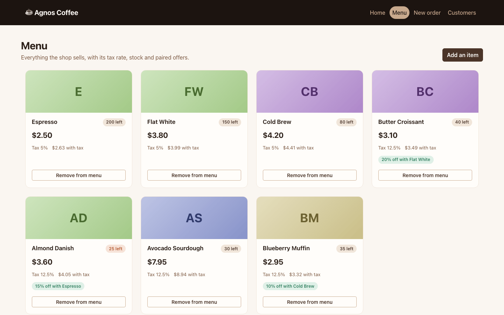
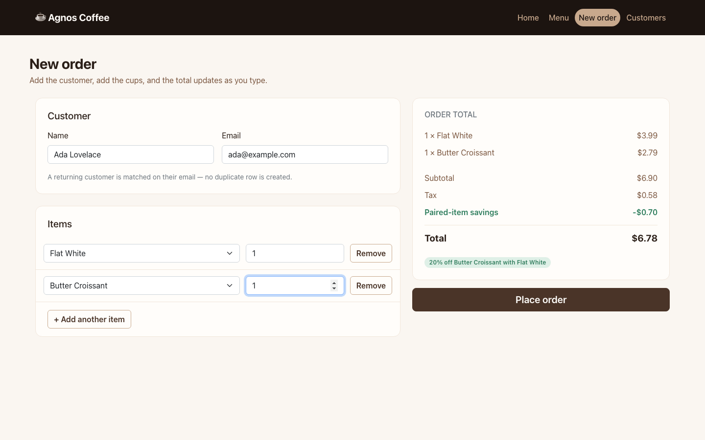

# Agnos Coffee Shop (frontend)

React frontend for a small coffee shop ordering system. It shows the menu, lets a cashier build an order, and prices the basket (tax plus "buy these two together" discounts) live in the browser before the order is sent. Built as a take-home exercise.

The backend is a separate Rails API (`agnos-coffee-shop-be`). This repo only contains the client and talks to `/api/v1`.

| Menu | Order with a paired discount |
| --- | --- |
|  |  |

## Screens

- `/`: home page with featured items and current offers
- `/items`: full menu with tax rate, price, stock and offers; items can be removed
- `/items/new`: add a menu item (Formik + Yup validation)
- `/order`: build an order, see the running total, place it and get a receipt
- `/customers`: paginated customer list

## Tech

React 18, React Router 6, React Bootstrap, axios, Formik/Yup. Tests use Jest, React Testing Library and msw. Created with Create React App.

## Setup

Node 18+ is required.

```bash
npm install
npm start
```

The app runs on http://localhost:3000 and expects the API at `http://localhost:3001/api/v1`. Run the backend and its seed (`rails db:seed`) to get the same menu and offers as in the screenshots. If the API isn't running, each screen shows an error with a Retry button.

To change the API URL or timeout, copy `.env.example` to `.env.local` and edit `REACT_APP_API_BASE_URL` / `REACT_APP_API_TIMEOUT_MS`. These values end up in the public bundle, so don't put secrets there.

There's also a Dockerfile (build with Node, serve with nginx) and `docker-compose.yml`. In the container the API URL can be set at startup with `API_BASE_URL`.

## Tests

```bash
npm run test:ci
npm run lint
```

API calls in tests are mocked with msw using the data in `src/test/seed.json`. More detail on test output is in [docs/build-and-test.md](docs/build-and-test.md).

## How pricing works

`src/domain/pricing.js` mirrors the backend's pricing logic: tax is added to the shelf price, then a paired discount is taken off the taxed price if the partner item is in the basket. Only one offer applies per line. The server's total is still the one that gets charged; the client only sends item ids and quantities.

## Todo

- Client and server can round some line totals differently by one cent.
- No order history screen and no item editing, even though the API supports both.
- Stock is shown but not checked in the order form.

## Author

[**Muhammad Nadeem**](https://github.com/dev-mnadeem)
