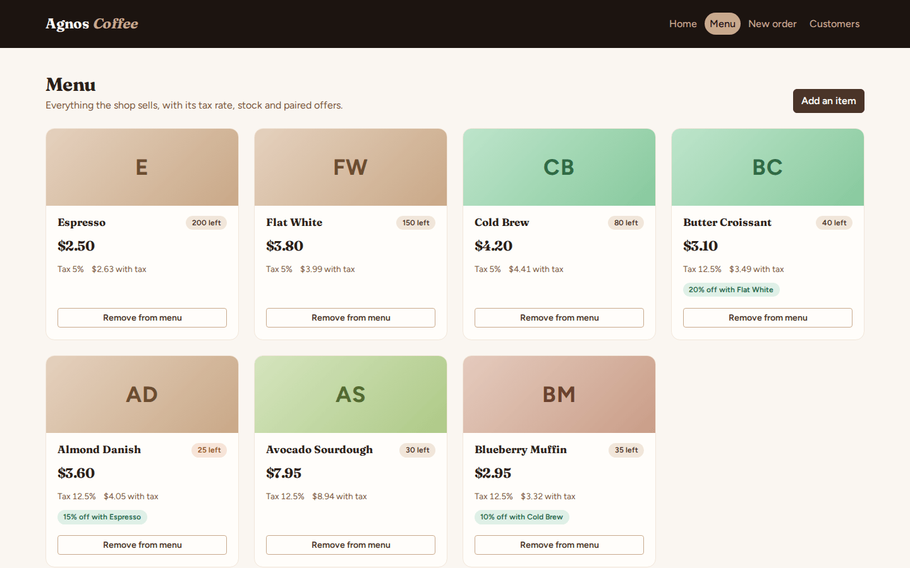
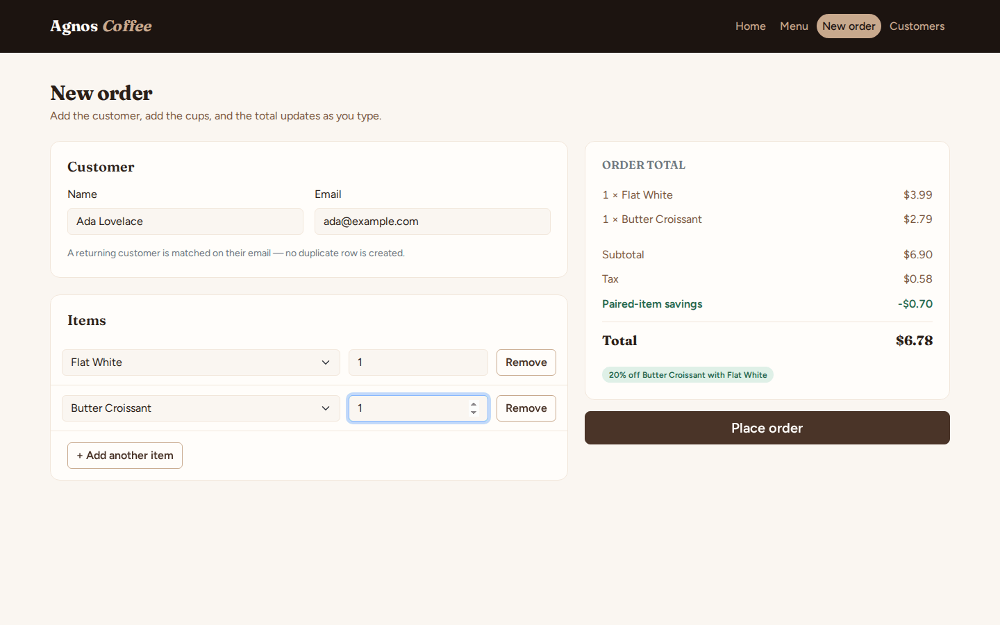
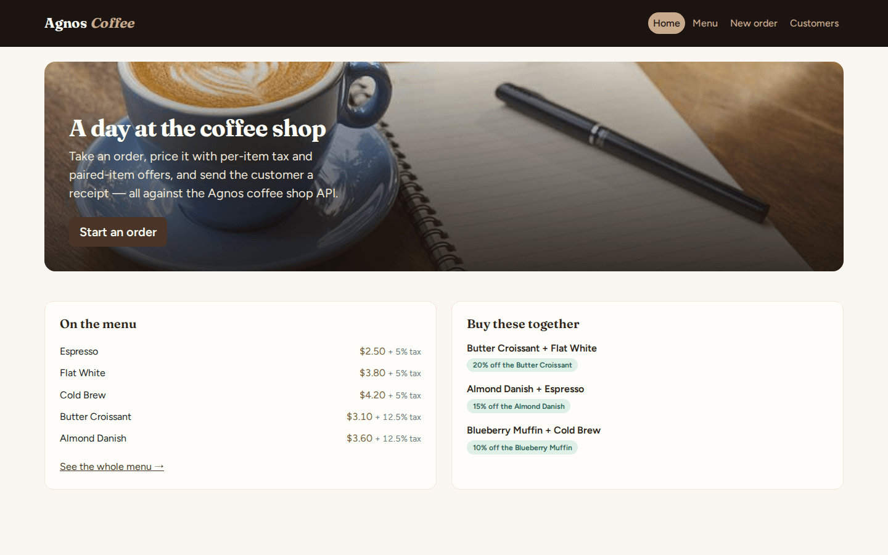
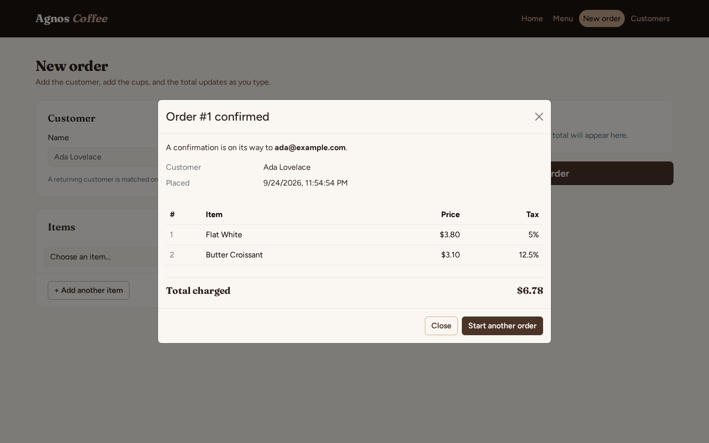
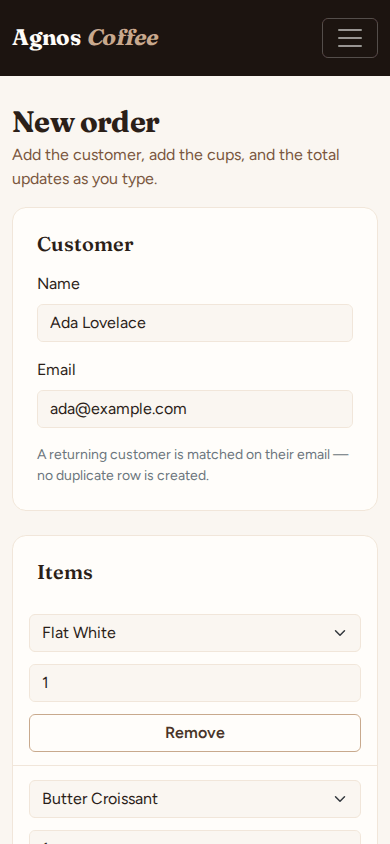
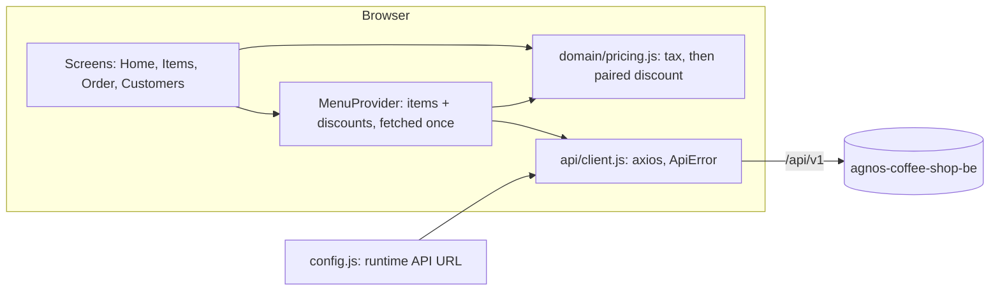

# Agnos Coffee Shop (frontend)

A till for a small coffee shop. The cashier picks items, the basket is priced in the browser as they type (per-item tax, then "buy these two together" discounts), and the order goes to the API with only item ids and quantities. Built as a take-home exercise.

The backend is a separate Rails API, `agnos-coffee-shop-be`. This repository holds only the React client, which talks to `/api/v1`.

| Menu                               | Till, with a paired discount applied               |
| ---------------------------------- | -------------------------------------------------- |
|  |  |

| Home                               | Receipt                                          | Phone                                                 |
| ---------------------------------- | ------------------------------------------------ | ----------------------------------------------------- |
|  |  |  |

## Screens

- `/`: featured items and the paired offers that are running.
- `/items`: the full menu with tax rate, price with tax, stock and offers. Items can be removed.
- `/items/new`: add a menu item (Formik and Yup validation).
- `/order`: build an order, see the running total, place it and get a receipt.
- `/customers`: everyone who has ordered, 25 per page.

Every screen that loads data has loading, empty and error states. An error says what went wrong and offers a retry, so an empty shop never looks like a broken API.

## How it fits together



- **One menu fetch per session.** `MenuProvider` loads the items and the discount table once. Following `meta.total_pages`, it reads every page and stops at 20 pages. The Items, Order and Home screens all read from it.
- **Pricing mirrors the server.** `src/domain/pricing.js` runs the same pipeline as the API's `Pricing::Calculator`. Tax is added to the shelf price first, then a paired discount comes off the taxed price if the partner item is in the basket. Only one offer applies per line, and each line is rounded half-up to cents. The server's total is still the one that gets charged.
- **Stock is checked before posting.** Quantities are summed per item across lines, and a line that asks for more than is left says how many remain. The API checks again.
- **One error type.** `api/client.js` turns every axios failure (HTTP error, timeout, no connection) into an `ApiError` carrying the API's own messages from `{ "errors": [...] }`.

## Running it

Node 22 is required (`.nvmrc`).

```bash
npm ci
npm start            # http://localhost:3000
```

The app expects the API at `http://localhost:3001/api/v1`. Run the backend and its seed (`rails db:seed`) to get the menu and offers shown in the screenshots. If the API is not running, each screen shows the error and a "Try again" button.

To point at a different API, copy `.env.example` to `.env.local` and set `VITE_API_BASE_URL` (and `VITE_API_TIMEOUT_MS` if needed). These values are compiled into the public bundle, so never put a secret in them.

### With Docker

```bash
docker compose up --build    # http://localhost:3000
```

The image builds the bundle with Node and serves it from nginx, unprivileged on port 8080. At start-up the entrypoint writes `API_BASE_URL` into `/config.js`, which the page reads before the bundle. That means one image can point at any API without a rebuild. Compose defaults it to `http://host.docker.internal:3001/api/v1`, which reaches an API running on the host. nginx sends `nosniff`, `X-Frame-Options` and `Referrer-Policy` on every response, caches hashed assets for a year, and never caches `index.html` or `config.js`.

## What the till sends and receives

When the cashier places a flat white and a butter croissant, the client sends only ids and quantities:

```http
POST /api/v1/orders
Content-Type: application/json

{
  "customer": { "name": "Ada Lovelace", "email": "ada@example.com" },
  "order_items": [
    { "item_id": 2, "quantity": 1 },
    { "item_id": 4, "quantity": 1 }
  ]
}
```

The API prices the order itself and returns the receipt shown in the modal:

```json
{
  "id": 1,
  "total_amount": 6.78,
  "created_at": "2026-09-24T23:54:54.882Z",
  "customer": { "id": 1, "name": "Ada Lovelace", "email": "ada@example.com" },
  "items": [
    { "id": 2, "name": "Flat White", "price": 3.8, "tax_rate": 5.0, "available_quantity": 149 },
    {
      "id": 4,
      "name": "Butter Croissant",
      "price": 3.1,
      "tax_rate": 12.5,
      "available_quantity": 39
    }
  ]
}
```

That 6.78 is 3.80 + 5% = 3.99 for the flat white, plus 3.10 + 12.5% = 3.4875, less 20% = 2.79 for the croissant. The browser shows the same figure before the order is posted. A failure comes back as `422 {"errors": ["Not enough Butter Croissant in stock"]}`, and the form shows that message and keeps what was typed.

## Tests and checks

```bash
npm test             # Vitest + React Testing Library, 79 tests
npm run coverage
npm run lint         # ESLint 9 with react, react-hooks and jsx-a11y rules
npm run format:check
npm run build
```

The suite never reaches a real server. `msw` intercepts every request at the network layer and answers from `src/test/seed.json`, the same rows the backend's seed creates. It runs with `onUnhandledRequest: 'error'`, so an unmocked endpoint fails the test. Figures from the last run are in [docs/build-and-test.md](docs/build-and-test.md).

`npm run screenshots` recaptures `docs/screenshots/` with Playwright against `npm run preview`. It answers every `/api/v1` call from the same seed file, so it needs no backend.

## Design notes

- Bootstrap 5 supplies the grid and form controls. `src/styles/theme.css` layers a roasted-coffee palette on top, with Fraunces for headings and prices and Figtree for text, so a Bootstrap upgrade does not mean redoing the look.
- Menu items have no photographs. Each card gets a monogram on a warm tint derived from the item's name, which stays stable across reloads.
- The till is usable from a keyboard. A skip link jumps past the navigation, every input has a label, and the pill colours clear 5:1 contrast.

## Not done

- No order history screen and no item editing, although the API supports both.
- Discounts can't be managed from the UI; they come from the backend seed.

## License

MIT, see [LICENSE](LICENSE).
